# Análise final do ensaio embarcado

Fonte: `results/ensaio/board_test.csv`, granularidade de 1 h, três usinas. Este documento reúne a análise completa do ensaio: série temporal, gaps, métricas gerais, desempenho dentro dos gaps e tempo de inferência.

## Convenções

- **gap artificial**: linha com `gap=True`, com duração de relógio conhecida. Os valores reais e preditos continuam no CSV e são usados na avaliação dentro dos gaps.
- **gap real**: ausência de linha por mais de 16 h entre leituras consecutivas. O maior intervalo do teste é de 280 h.
- **blocos artificiais**: o sorteio não cobre gaps reais (intervalos maiores que 16 h entre leituras consecutivas) e blocos menores que 12 h ficam dentro do dia, sem entrar na pausa noturna.
- **série temporal**: as linhas são mantidas contínuas na pausa noturna, em buracos menores que 6 h e nos blocos artificiais. Elas quebram em buracos reais de 6 h ou mais que não sejam a noite.
- **tempo de inferência**: `inference_us`, medido no firmware ao redor de `runInference()` e gravado por amostra.

## Inventário

- Linhas: 12126 (4042 por usina).
- Linhas em gaps artificiais: 551 (4.5%).
- Blocos artificiais por usina: 6.
- Gap real: 1 bloco(s); maior: 280 h.
- Linhas com `real` NaN: 0 (referência ausente).

### Gaps reais

| inicio | fim | horas |
| --- | --- | --- |
| 2025-08-22 16:00:00 | 2025-09-03 08:00:00 | 280 |

## Série temporal

A série completa usa somente `ifpee1`. O detalhe dos blocos artificiais é separado por duração e por inversor; cada figura mostra uma usina e os blocos daquela duração. Dentro deles, real e predito aparecem pontilhados.

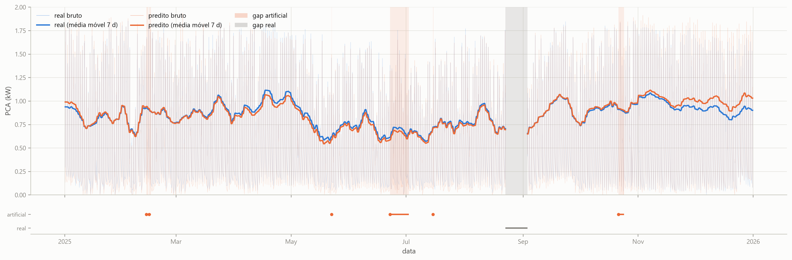

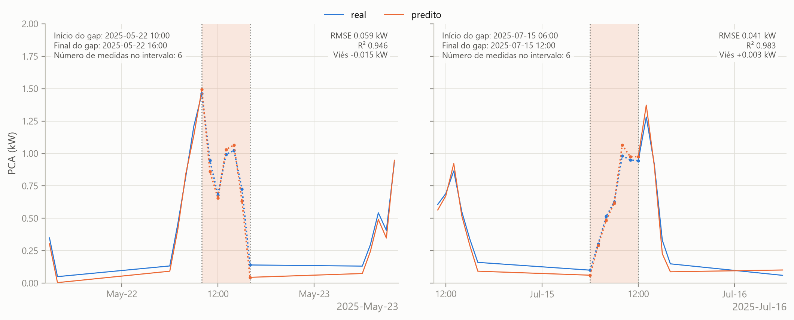

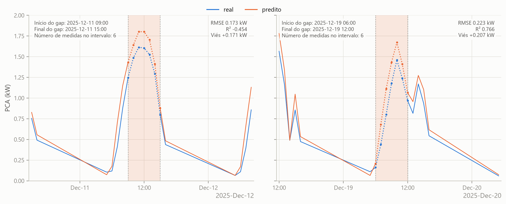

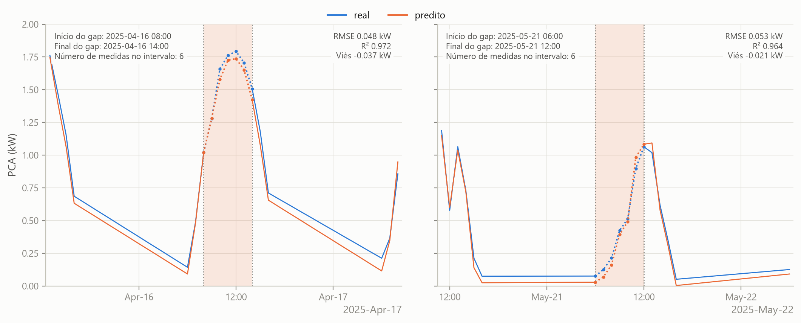

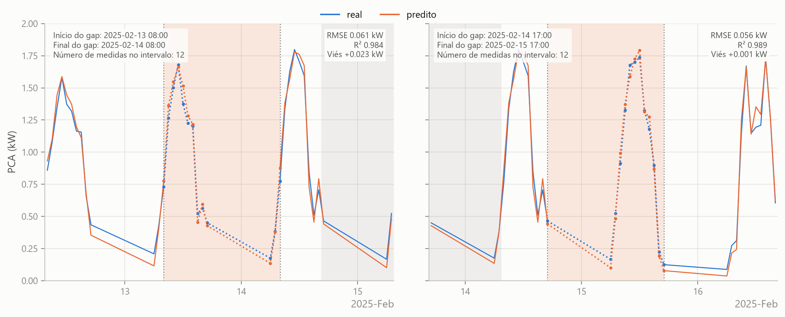

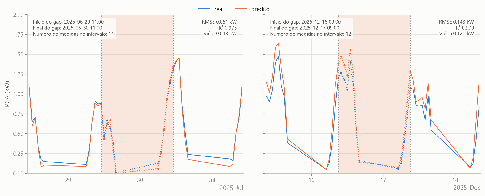

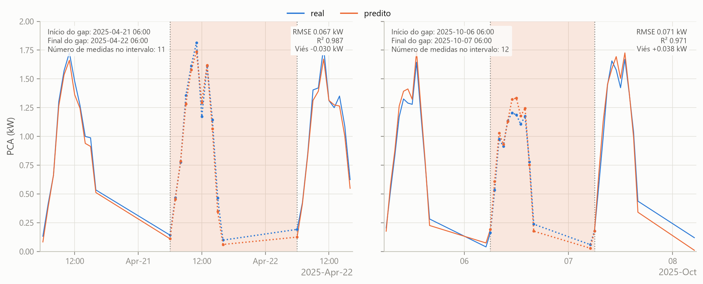

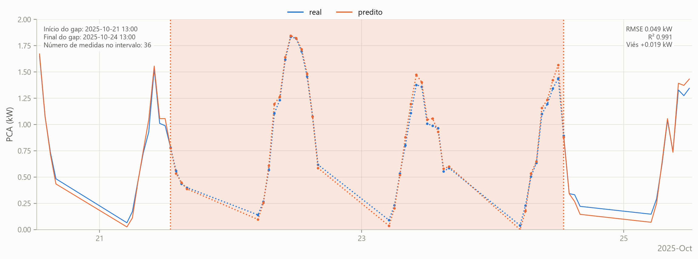

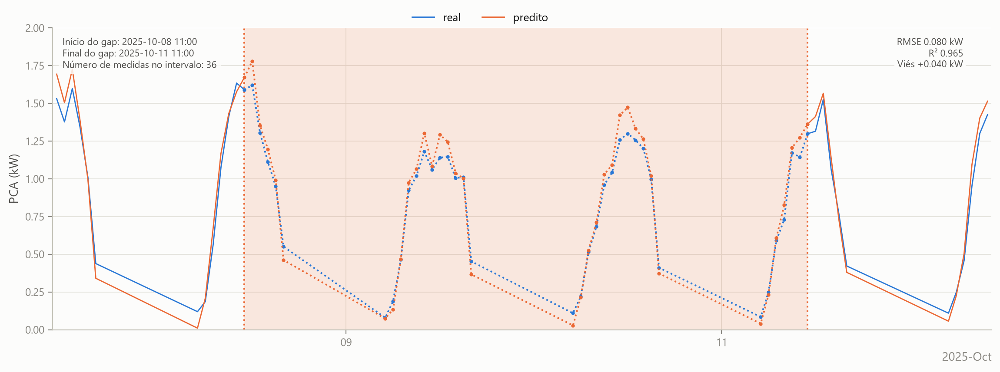

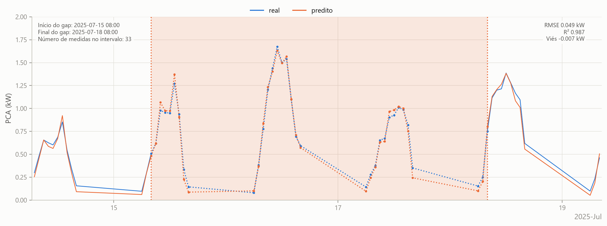

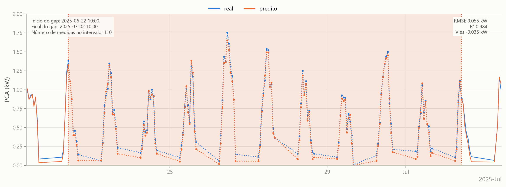

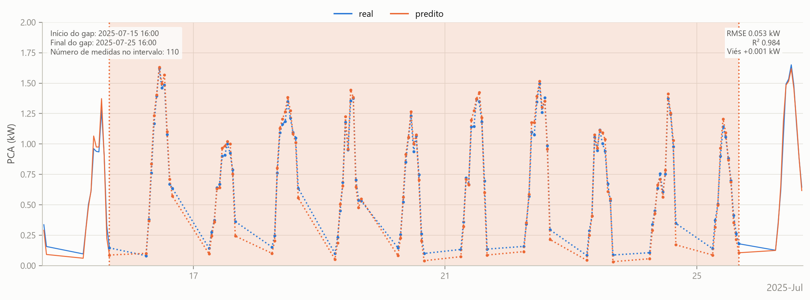

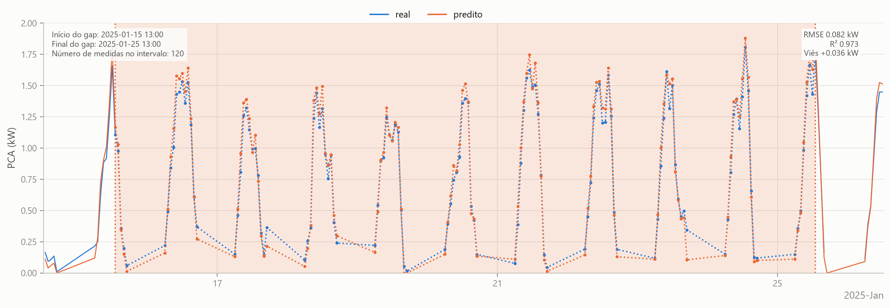

## Métricas gerais

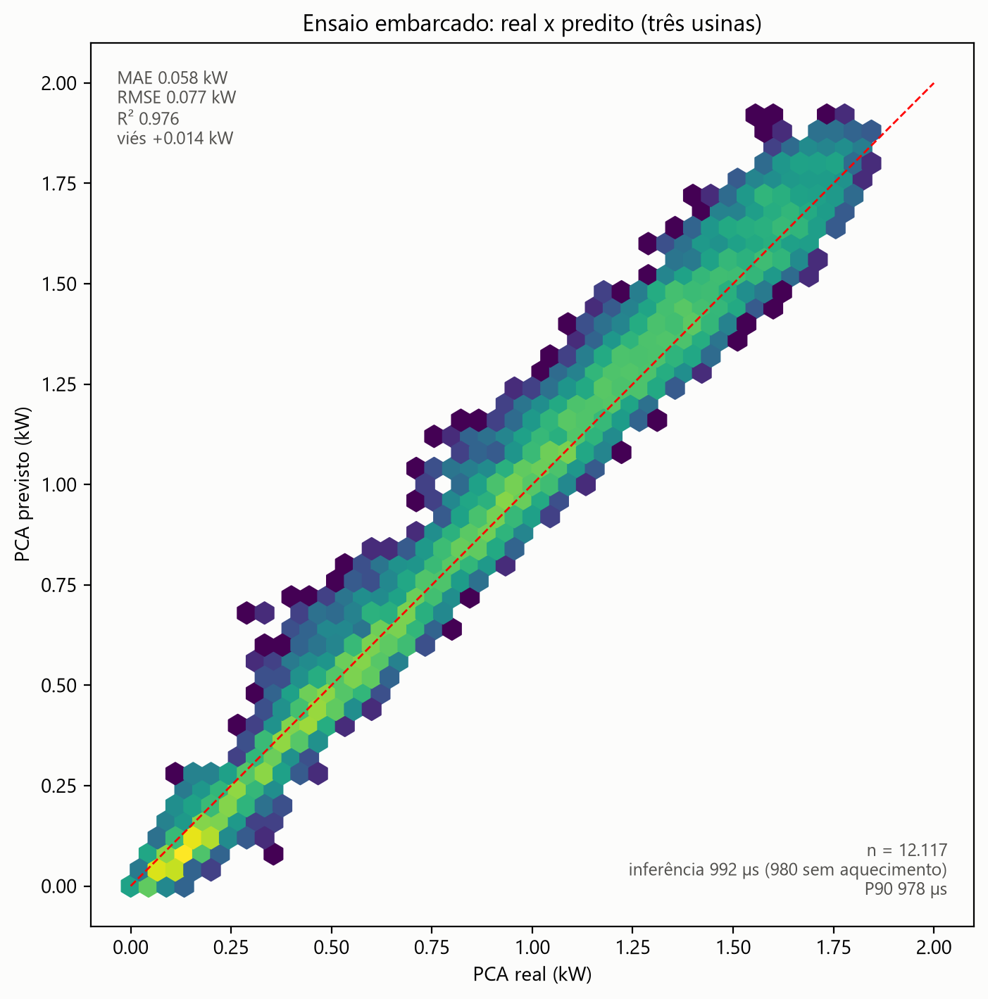

| escopo | inversor | n | MAE (kW) | RMSE (kW) | R² | viés (kW) | MAPE (%) | P90 (kW) | inferência média (µs) | inferência P90 (µs) |
| --- | --- | --- | --- | --- | --- | --- | --- | --- | --- | --- |
| total | todos | 12126 | 0.0584 | 0.0765 | 0.9757 | 0.0145 | 12.2934 | 0.1246 | 991.9 | 978 |
| total | ifpee1 | 4042 | 0.0548 | 0.0698 | 0.9802 | 0.0048 | 11.9605 | 0.1114 | 991.911 | 978 |
| total | ifpee2 | 4042 | 0.0629 | 0.0843 | 0.9693 | 0.0291 | 12.8785 | 0.1405 | 991.89 | 978 |
| total | ifpee3 | 4042 | 0.0576 | 0.0746 | 0.9772 | 0.0095 | 12.041 | 0.1202 | 991.9 | 978 |
| fora dos gaps | todos | 11575 | 0.0586 | 0.0767 | 0.9757 | 0.0147 | 12.2881 | 0.1252 | 992.582 | 978 |
| fora dos gaps | ifpee1 | 3860 | 0.0553 | 0.0705 | 0.9799 | 0.0058 | 11.9697 | 0.1127 | 992.583 | 978 |
| fora dos gaps | ifpee2 | 3861 | 0.0629 | 0.0843 | 0.9696 | 0.0291 | 12.876 | 0.14 | 992.567 | 978 |
| fora dos gaps | ifpee3 | 3854 | 0.0576 | 0.0746 | 0.9772 | 0.009 | 12.0179 | 0.1203 | 992.594 | 978 |
| dentro dos gaps | todos | 551 | 0.0555 | 0.072 | 0.9766 | 0.011 | 12.4044 | 0.1082 | 977.584 | 978 |
| dentro dos gaps | ifpee1 | 182 | 0.0448 | 0.054 | 0.9865 | -0.0159 | 11.7656 | 0.0902 | 977.643 | 978 |
| dentro dos gaps | ifpee2 | 181 | 0.0631 | 0.0846 | 0.9627 | 0.0282 | 12.9313 | 0.1597 | 977.453 | 978 |
| dentro dos gaps | ifpee3 | 188 | 0.0584 | 0.074 | 0.9783 | 0.0204 | 12.5156 | 0.1193 | 977.654 | 978 |

## Métricas dentro dos gaps

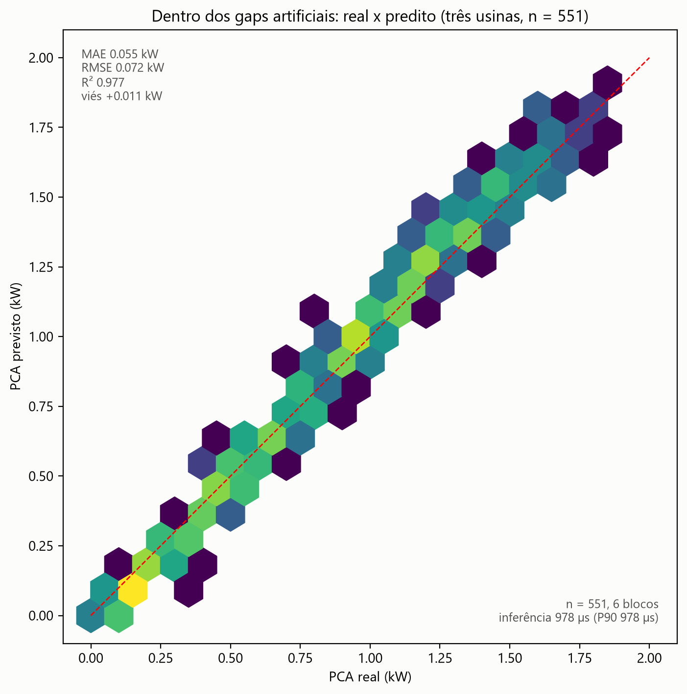

### Por duração

| duração | inversor | blocos | n | MAE (kW) | RMSE (kW) | R² | R² reportável | viés (kW) | MAPE (%) | P90 (kW) | inferência média (µs) | inferência P90 (µs) |
| --- | --- | --- | --- | --- | --- | --- | --- | --- | --- | --- | --- | --- |
| 6 h | todos | 5 | 36 | 0.0919 | 0.1224 | 0.9452 | True | 0.0513 | 14.0703 | 0.205 | 977.389 | 978 |
| 6 h | ifpee1 | 2 | 12 | 0.0427 | 0.0509 | 0.9787 | True | -0.0059 | 8.0366 | 0.0851 | 977.583 | 978 |
| 6 h | ifpee2 | 2 | 12 | 0.1888 | 0.1993 | 0.8023 | True | 0.1888 | 20.31 | 0.2535 | 976.917 | 978 |
| 6 h | ifpee3 | 2 | 12 | 0.044 | 0.0509 | 0.9938 | True | -0.0291 | 13.8643 | 0.0785 | 977.667 | 978 |
| 24 h | todos | 5 | 70 | 0.063 | 0.0816 | 0.9736 | True | 0.0247 | 13.2094 | 0.1455 | 978.157 | 978 |
| 24 h | ifpee1 | 2 | 24 | 0.0493 | 0.0589 | 0.987 | True | 0.0123 | 7.6238 | 0.0941 | 977.667 | 978 |
| 24 h | ifpee2 | 2 | 23 | 0.0835 | 0.109 | 0.9342 | True | 0.0569 | 20.3126 | 0.1854 | 977.478 | 978 |
| 24 h | ifpee3 | 2 | 23 | 0.0568 | 0.0691 | 0.9816 | True | 0.0053 | 11.9345 | 0.1184 | 979.348 | 978 |
| 3 d | todos | 3 | 105 | 0.048 | 0.0613 | 0.9821 | True | 0.0182 | 10.0883 | 0.0984 | 977.743 | 978 |
| 3 d | ifpee1 | 1 | 36 | 0.0392 | 0.0488 | 0.9906 | True | 0.0195 | 9.7641 | 0.0833 | 978.194 | 978 |
| 3 d | ifpee2 | 1 | 36 | 0.0643 | 0.0799 | 0.9646 | True | 0.0402 | 10.7092 | 0.1417 | 977.611 | 978 |
| 3 d | ifpee3 | 1 | 33 | 0.0398 | 0.049 | 0.9872 | True | -0.0072 | 9.7645 | 0.0827 | 977.394 | 978 |
| 10 d | todos | 3 | 340 | 0.0524 | 0.0654 | 0.9794 | True | 0.0017 | 12.7776 | 0.1045 | 977.438 | 978 |
| 10 d | ifpee1 | 1 | 110 | 0.0459 | 0.0547 | 0.9837 | True | -0.0347 | 13.731 | 0.0904 | 977.464 | 978 |
| 10 d | ifpee2 | 1 | 110 | 0.0447 | 0.0535 | 0.9836 | True | 0.0007 | 11.3103 | 0.0793 | 977.455 | 978 |
| 10 d | ifpee3 | 1 | 120 | 0.0653 | 0.0822 | 0.9729 | True | 0.0358 | 13.2486 | 0.1437 | 977.4 | 978 |

### Por bloco

| inversor | bloco | duração | início | fim observado | n | MAE (kW) | RMSE (kW) | R² | R² reportável | viés (kW) |
| --- | --- | --- | --- | --- | --- | --- | --- | --- | --- | --- |
| ifpee1 | 1 | 24 h | 2025-02-13 08:00 | 2025-02-14 07:00 | 12 | 0.0489 | 0.0612 | 0.9839 | True | 0.0232 |
| ifpee1 | 2 | 24 h | 2025-02-14 17:00 | 2025-02-15 16:00 | 12 | 0.0496 | 0.0565 | 0.9893 | True | 0.0014 |
| ifpee1 | 3 | 6 h | 2025-05-22 10:00 | 2025-05-22 15:00 | 6 | 0.0525 | 0.059 | 0.9462 | False | -0.015 |
| ifpee1 | 4 | 10 d | 2025-06-22 10:00 | 2025-07-02 09:00 | 110 | 0.0459 | 0.0547 | 0.9837 | True | -0.0347 |
| ifpee1 | 5 | 6 h | 2025-07-15 06:00 | 2025-07-15 11:00 | 6 | 0.033 | 0.0413 | 0.9833 | False | 0.0031 |
| ifpee1 | 6 | 3 d | 2025-10-21 13:00 | 2025-10-24 12:00 | 36 | 0.0392 | 0.0488 | 0.9906 | True | 0.0195 |
| ifpee2 | 1 | 24 h | 2025-06-29 11:00 | 2025-06-30 10:00 | 11 | 0.0393 | 0.0514 | 0.9755 | True | -0.0131 |
| ifpee2 | 2 | 10 d | 2025-07-15 16:00 | 2025-07-25 15:00 | 110 | 0.0447 | 0.0535 | 0.9836 | True | 0.0007 |
| ifpee2 | 3 | 3 d | 2025-10-08 11:00 | 2025-10-11 10:00 | 36 | 0.0643 | 0.0799 | 0.9646 | True | 0.0402 |
| ifpee2 | 4 | 6 h | 2025-12-11 09:00 | 2025-12-11 14:00 | 6 | 0.1709 | 0.1729 | -0.4542 | False | 0.1709 |
| ifpee2 | 5 | 24 h | 2025-12-16 09:00 | 2025-12-17 08:00 | 12 | 0.1241 | 0.1426 | 0.909 | True | 0.1212 |
| ifpee2 | 6 | 6 h | 2025-12-19 06:00 | 2025-12-19 11:00 | 6 | 0.2067 | 0.2226 | 0.7663 | False | 0.2067 |
| ifpee3 | 1 | 10 d | 2025-01-15 13:00 | 2025-01-25 12:00 | 120 | 0.0653 | 0.0822 | 0.9729 | True | 0.0358 |
| ifpee3 | 2 | 6 h | 2025-04-16 08:00 | 2025-04-16 13:00 | 6 | 0.0387 | 0.0483 | 0.9716 | False | -0.0375 |
| ifpee3 | 3 | 24 h | 2025-04-21 06:00 | 2025-04-21 16:00 | 11 | 0.0548 | 0.0674 | 0.9867 | True | -0.0301 |
| ifpee3 | 4 | 6 h | 2025-05-21 06:00 | 2025-05-21 11:00 | 6 | 0.0493 | 0.0533 | 0.964 | False | -0.0207 |
| ifpee3 | 5 | 3 d | 2025-07-15 08:00 | 2025-07-18 07:00 | 33 | 0.0398 | 0.049 | 0.9872 | True | -0.0072 |
| ifpee3 | 6 | 24 h | 2025-10-06 06:00 | 2025-10-07 05:00 | 12 | 0.0585 | 0.0707 | 0.9707 | True | 0.0378 |

A coluna `R² reportável` é `False` quando o grupo tem menos de 10 amostras ou `real` sem dispersão. Nesses casos, o R² bruto fica no CSV, mas não deve ser citado.

## Tempo de inferência

| inversor | n | média geral (µs) | mediana geral (µs) | P90 geral (µs) | P99 geral (µs) | máximo geral (µs) | média sem aquecimento (µs) | mediana sem aquecimento (µs) | P90 sem aquecimento (µs) | P99 sem aquecimento (µs) | máximo sem aquecimento (µs) | amostras descartadas |
| --- | --- | --- | --- | --- | --- | --- | --- | --- | --- | --- | --- | --- |
| todos | 12126 | 991.9 | 978 | 978 | 978 | 11801 | 980.3 | 978 | 978 | 978 | 11733 | 18 |
| ifpee1 | 4042 | 991.9 | 978 | 978 | 978 | 11801 | 980.3 | 978 | 978 | 978 | 11725 | 6 |
| ifpee2 | 4042 | 991.9 | 978 | 978 | 978 | 11801 | 980.3 | 978 | 978 | 978 | 11733 | 6 |
| ifpee3 | 4042 | 991.9 | 978 | 978 | 978 | 11800 | 980.3 | 978 | 978 | 978 | 11728 | 6 |

## Síntese

- No teste completo, MAE de 0.0584 kW e R² de 0.9757.
- Fora dos gaps, MAE de 0.0586 kW e R² de 0.9757.
- Dentro dos gaps, MAE de 0.0555 kW e R² de 0.9766 nas três usinas; em ifpee1, MAE de 0.0448 kW e R² de 0.9865.
- Entre as durações, o menor MAE agregado é o de 3 d (0.0480 kW) e o maior é o de 6 h (0.0919 kW).
- Inferência: média bruta de 991.9 µs, 980.3 µs sem aquecimento, mediana de 978.0 µs e máximo de 11733 µs.

## Arquivos

### Figuras

- `figuras/analise_serie_ifpee1.png`
- `figuras/analise_blocos_6h_ifpee1.png`
- `figuras/analise_blocos_6h_ifpee2.png`
- `figuras/analise_blocos_6h_ifpee3.png`
- `figuras/analise_blocos_24h_ifpee1.png`
- `figuras/analise_blocos_24h_ifpee2.png`
- `figuras/analise_blocos_24h_ifpee3.png`
- `figuras/analise_blocos_3d_ifpee1.png`
- `figuras/analise_blocos_3d_ifpee2.png`
- `figuras/analise_blocos_3d_ifpee3.png`
- `figuras/analise_blocos_10d_ifpee1.png`
- `figuras/analise_blocos_10d_ifpee2.png`
- `figuras/analise_blocos_10d_ifpee3.png`
- `figuras/analise_hexbin_total.png`
- `figuras/analise_hexbin_gaps.png`

### Tabelas (CSV)

- `ensaio/analise_gaps_reais.csv`
- `ensaio/analise_metricas.csv`
- `ensaio/analise_inferencia.csv`
- `ensaio/analise_gaps_duracao.csv`
- `ensaio/analise_gaps_blocos.csv`

## Ressalvas

- A média bruta de inferência inclui as primeiras amostras de cada usina, que chegam a 1,5 a 11,8 ms.
- O R² de grupos com menos de 10 amostras não é interpretável; a coluna `R² reportável` marca o que pode ser citado.
- Blocos que caem sobre horários já ausentes na série real podem ter poucas leituras; a tabela por bloco mostra o n de cada um.
- O ensaio é offline: o firmware recebe lotes do servidor em vez de ler sensores reais. Os gaps são artificiais e não validam falhas reais de telemetria.
